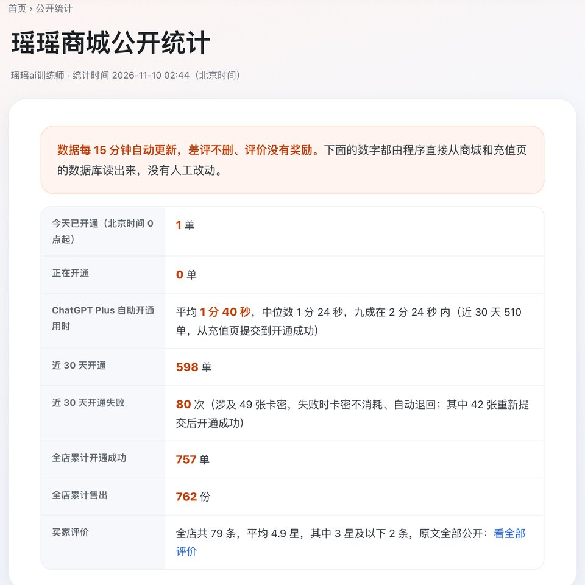
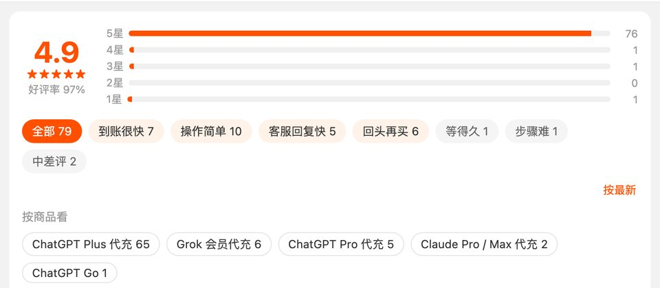
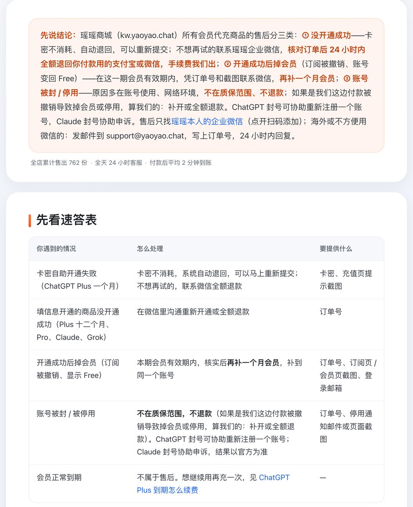

# ai云充靠谱吗 2026：公开能查到什么、代充怎么自己核对

> 2026-11-11 更新

**先说结论：** 「ai云充」在必应上半年有四千多次搜索，但公开资料里查不到它的经营者、价格表和退款条款，靠不靠谱没法替你下结论。能做的是教你用同一套办法自己核对任何一家代充。用这套办法量过的瑶瑶ai训练师的商城，[Plus 一个月 ¥129 自助开通](https://kw.yaoyao.chat/item/5?utm_source=github&utm_medium=readme&utm_campaign=aiyunchong&utm_content=plus-top)，付款走支付宝或微信，平均 2 分钟开好，全程不碰密码；没开成 24 小时内全额退，单量和评价都挂在公开页面上。要开 Claude 的看 [Claude Pro 会员 ¥159](https://kw.yaoyao.chat/item/12?utm_source=github&utm_medium=readme&utm_campaign=aiyunchong&utm_content=top-claude)。下单填券码 **888888** 再减 ¥3。

- **查到了什么**：必应自己的 AI 摘要把「ai云充」解释成 AI 会员代充的统称，不是哪一家的官方名字。
- **没查到什么**：谁在经营、各档多少钱、开通失败和掉会员怎么处理，公开页面都没找到。
- **自己怎么验**：看会员开在谁的号上、要交什么、退款有没有写成字、有没有能核对的数据、钱付给了谁，下面一条条讲。
- **谁不用买**：有能在官网付款的卡、人在官方支持地区的，官网自己订；已经在别家开着会员、用得好好的，没必要换。

*图：瑶瑶商城公开统计页，开通、失败次数、评价都写在页面上（kw.yaoyao.chat/tongji/，2026-11-10 截图）*

## 「ai云充」到底指哪一家

搜「ai云充」的人，脑子里想的可能不是同一样东西。2026-11-10 在必应搜这个词，必应自己的 AI 摘要把「AI云充」解释成中文用户对"AI 会员代充、API 充值"的统称，不是哪一家的官方叫法。也就是说，这个词更像一个品类的叫法，搜它的人里，有的想找某一家店，有的只是想找"能帮忙开 AI 会员的地方"。

所以，如果你是看到有人推荐"ai云充"才来搜的，先弄清楚推荐的人指的是哪一个网址。名字像、域名像的店不止一家，付款之前，网址要跟推荐你的人当面对一遍；最好让对方直接把网址发成文字，而不是发一张截图，截图里的网址没法点开核对。

**这篇不放任何同行网址，不截同行页面，也不转述同行页面上的内容**，只讲一套任何一家都能套用的核对办法。

## ai云充 公开能查到的和查不到的

2026-11-10 在必应和公开资料里查「ai云充」，下面这几项都没有找到能对上的公开说明：

- **谁在经营**：没看到公司名或负责人。
- **价格**：没找到公开的价格表。
- **退款和掉会员**：没找到写成文字的处理规则。
- **单量、评价**：没找到公开的统计页或评价页。

"查不到"不代表它没有，可能写在要登录、要下单才能看到的地方，也可能是在聊天里口头说的，外人看不到。所以这篇不替任何一家下结论。真想买，就把上面四项直接问卖家，让他发文字版，再拿下面 7 件事逐条对一遍。

## 任何一家代充，下单前自己核对这 7 件事

不管是 ai云充、瑶瑶，还是朋友推荐的别家，都可以用同一套办法核对。每一条都写了"合格的样子"，你一眼就能对上。

**1. 会员开在谁的账号上**
合格的样子：开在你自己注册的号上，聊天记录、项目都在原处，邮箱和找回方式在你手里。
要警惕：发你一个账号密码；"拼车""合租""几个人一个号"。这些是共享号或成品号，三家官方条款都不允许分享账号凭据。几个人合用一个号会出什么事，见 [ChatGPT 会员能几个人共享](https://kw.yaoyao.chat/guide/chatgpt-gongxiang.html?utm_source=github&utm_medium=readme&utm_campaign=aiyunchong&utm_content=guide)。

**2. 要你交出什么**
合格的样子：不要密码、不要短信或邮箱验证码。要是让你粘贴登录信息，说清楚粘到哪个页面、存不存、怎么作废。
要警惕：让你把密码发到聊天框、让你关掉二次验证、让你把登录信息发到微信或 QQ。

**3. 退款有没有写成字**
合格的样子：开通失败、本期内掉会员、账号被封，三种情况各自怎么处理，写在页面上，连"哪些不管"也写明白。
要警惕：只有一句"有质保""放心用"，或者只写了不退的情况、没写退的情况。

**4. 有没有能核对的数据**
合格的样子：单量、开通失败次数、评价挂在公开页面上，能看到差评，有统计时间。
要警惕：只有截图，没有能点开的页面；"已服务几十万人"这类说法没有任何地方能核对。

**5. 价格讲不讲得通**
合格的样子：比官方折算价略高或略低，说得出差价是什么（汇率、服务费、售后）。
要警惕：便宜一半以上、又说不清为什么。付款来源不干净的会员，可能过一阵被官方撤销，代充圈里说的"黑卡"就是这类风险。一个店的价格是怎么算出来的，可以参考 [Plus 代充 ¥129 为什么便宜](https://kw.yaoyao.chat/guide/plus-129-weishenme.html?utm_source=github&utm_medium=readme&utm_campaign=aiyunchong&utm_content=guide)，那篇把成本拆开写了。

**6. 出了事找得到人**
合格的样子：客服入口写在卖家自己的网站上，付款前就能问到；卡密和订单能自己查。
要警惕：付款后换人、失联；卖卡的和负责开通的是两拨人，出了问题互相推。

**7. 钱付给了谁**
合格的样子：付款页写明收款方是谁，付款方式就是常见的支付宝、微信扫码，付完能在账单里看到这笔钱，出了问题能原路退回。
要警惕：让你转账给一个说不清身份的私人账号、让你先充"余额"或买"点卡"再兑换、付款页和下单页不是同一家。付之前截一张付款页的图，账单里那一笔也留着，真要退款时这是最直接的凭证。

上面 7 件事，最省事的用法是挑三条最在意的，原话发给卖家，看他怎么回：回得具体、肯写成文字、还给你网页链接的，比只回"放心""没问题"的稳得多。想要一张能逐项打勾的清单，用 [代充下单前 8 项自查](https://kw.yaoyao.chat/guide/heshi-maijia.html?utm_source=github&utm_medium=readme&utm_campaign=aiyunchong&utm_content=guide)；几家公开标价的 Plus 代充放在一起比，见 [ChatGPT Plus 代充怎么选](https://kw.yaoyao.chat/guide/daichong-duibi.html?utm_source=github&utm_medium=readme&utm_campaign=aiyunchong&utm_content=guide)。

## 粘贴登录信息的开通页，怎么判断安不安全

这是同行很少写透、客人又最常卡住的一个地方。很多 ChatGPT 代充都会让你打开一个网址，复制一整段 JSON 格式的登录信息，粘贴到开通页。它不是密码，但在失效前，拿到它的人能以你的身份登录。粘贴之前，按顺序过这四关：

**第一关：网址对不对。** 只在卖家自己网站上写明的开通页粘贴。别人私信发来的"新网址""备用网址"，先跟卖家官网对一遍。

**第二关：页面有没有说存不存。** 好的开通页会写明这段信息存不存、存多久。比如瑶瑶的充值页写的是不保存、开通后退出所有设备就作废；订单页填写的那种加密保存，开通成功 7 天后自动删除。什么都不写的，要多问一句。

**第三关：提交前核对邮箱。** 粘贴以后，正规的页面会自动认出账号邮箱让你确认。邮箱对不上就停，别点开通。开错了号，大多数店不退。

**第四关：开通后让它失效。** 会员到账以后，去 ChatGPT 设置里点"退出所有设备"。按 OpenAI 的 [退出所有设备官方说明](https://help.openai.com/en/articles/9243857)，别处的登录最多半小时内全部断开，那段登录信息随之失效。

还有一个常见卡点：复制完隔了很久才去粘贴，或者在微信里打开链接复制，经常复制不全或已经过期，开通就会失败。开个无痕窗口重新登录，复制完马上提交，基本能解决。提交后提示失败、过期、付款被拒这些情况，逐条排查见 [ChatGPT Plus 充值失败怎么办](https://kw.yaoyao.chat/guide/plus-shibai.html?utm_source=github&utm_medium=readme&utm_campaign=aiyunchong&utm_content=guide)。

## 搜同行名字之前，先想清楚自己要什么

很多人搜一个代充店的名字，是因为在群里、评论区看到有人提了一句。这时候与其研究这一家，不如先回答自己三个问题，答完再选店会快很多：

**你要开哪一家的会员？** ChatGPT、Claude、Grok 的开通方式差别很大。ChatGPT 多数店是粘贴登录信息开通；Claude 有的店只要组织 ID；Grok 要电脑浏览器拿 sso。一家店只卖 ChatGPT，你却想开 Claude，名气再大也帮不上。

**你能接受交出什么？** 有人完全不想让别人碰登录状态，那就优先选只要组织 ID 的 Claude，或者自己想办法官网付款；能接受粘贴、但要求开完就作废的，问清楚店里存不存、存多久。

**出了问题你想找谁？** 有的店卖货和开通分在两个网站，出了事要先找收你钱的那家；有的店从下单到售后是同一个人。图省心的，选后一种。

把这三条想清楚，再拿前面那 7 件事去核对，比单看名字靠谱得多。名字只是入口，真正决定体验的是开在谁号上、交什么、出事谁管。

## 用同一把尺子量一量瑶瑶ai训练师的店

既然要你自己核对，就把瑶瑶这边的答案也摆出来，每一条都附上能点开核对的地方：

| 核对项 | 瑶瑶ai训练师的答案 | 在哪核对 |
|---|---|---|
| 开在谁的号上 | 你自己的号，只归你一个人用 | 商品页"充到你自己的账号" |
| 要交什么 | ChatGPT 粘一段登录信息，Claude 只要组织 ID，Grok 粘 sso，都不要密码 | 商品页、事实卡 |
| 退款 | Plus 一个月失败卡密自动退回可重提；要退钱 24 小时内原路全额退，手续费店里出 | 售后与质保规则 |
| 掉会员 | 本期内掉会员，凭订单号和截图同一个号补一个月 | 售后与质保规则 |
| 封号 | 不在质保范围、不退款；ChatGPT 可协助重注册，Claude 协助官方申诉 | 售后与质保规则 |
| 数据 | 累计开通 757 单、售出 762 份，近 30 天全站开通 598 单 | 公开统计页 |
| 评价 | 79 条，平均 4.9 星，只有开通成功的能评，差评不删、没有奖励 | 买家评价页 |
| 谁在经营 | 瑶瑶ai训练师本人，2023 年 10 月起做 AI 科普，2026 年 3 月开商城 | 关于瑶瑶 |
| 客服 | 瑶瑶本人企业微信，全天 24 小时；不用微信的发 support@yaoyao.chat | 商品页 |

经营者是谁、各平台本人账号有哪些，写在 [关于瑶瑶ai训练师](https://kw.yaoyao.chat/guide/guanyu-yaoyao.html?utm_source=github&utm_medium=readme&utm_campaign=aiyunchong&utm_content=guide)。

*图：瑶瑶商城评价页顶部，79 条评价的星级分布和标签（kw.yaoyao.chat/pingjia，2026-11-10 截图）*

不占便宜的地方也照实写：账号被封不退；ChatGPT 要粘贴一段登录信息；店里的 Claude、Grok 价格比官方折算价高一些。这几条下单前就该知道。

## 想在瑶瑶店里开：三步

1. 进商品页挑档位、付钱，支付宝微信都行，事先不必加任何人。
2. ChatGPT Plus 一个月：付款后拿到卡密，到 cz.yaoyao.chat 粘贴登录信息，自助开通；Claude、Grok、ChatGPT Pro：在订单页填组织 ID 或 sso，瑶瑶在线开通。
3. 平均 2 分钟到账。有问题扫码加企业微信，发订单号。

头一回下单的人，十个里有七八个先选 Plus。它到底能做什么、该不该一次买几个月，GitHub 上那篇 [Plus 选购说明](https://github.com/yaoyao-chat/plus) 讲得比较全。不想交任何登录状态的，可以考虑 Claude Pro（店里 ¥159 一个月），它只认组织 ID。

售后三种情况各自怎么处理，原文在下面这张速查表里。

*图：瑶瑶卡网售后速查表，失败、掉会员、封号分别怎么处理（kw.yaoyao.chat/guide/shouhou-zhibao.html，2026-11-10 截图）*

## 常见问题

**问：ai云充是正规平台吗？**
"正规"没有官方认证这一说。三家官方的购买入口里都没有代充；xAI 定价页（[x.ai/pricing](https://x.ai/pricing)）问答里说得最直白：只由官方直接销售。剩下能做的，是按上面 7 件事自己核对。ai云充的经营者和条款，公开资料查不到。

**问：ai云充和瑶瑶哪个便宜？**
ai云充的价格在公开页面上没找到，没法比。瑶瑶的 ChatGPT Plus 一个月 ¥129；官网标价 20 美元一个月，见 OpenAI 的 [Plus 介绍页](https://help.openai.com/articles/6950777)。

**问：粘贴登录信息开错了号，能退吗？**
各家规则不一样，先找卖给你的那家，按他写成文字的条款处理；没写的，就是下单前该问清楚的一条。以后提交前，先核对页面识别出来的邮箱，对不上就停。

**问：代充开的会员被撤销了怎么办？**
看卖家的书面条款。瑶瑶这边本期内掉会员，同一个号补一个月；不是付款原因、而是账号被封的，不在质保范围。

**问：代充停了、跑路了，还有别的路吗？**
有，苹果内购、礼品卡、虚拟卡都有人用，各有门槛。见 [代充渠道停了怎么办](https://kw.yaoyao.chat/guide/daichong-tingle.html?utm_source=github&utm_medium=readme&utm_campaign=aiyunchong&utm_content=guide)。

**问：ChatGPT 订阅能找 OpenAI 退款吗？**
官网自己订的按官方规则申请；代充开的不是你本人付的款，找官方退不了，只能按卖家条款。官方规则见 [ChatGPT 订阅能退款吗](https://kw.yaoyao.chat/guide/chatgpt-tuikuan.html?utm_source=github&utm_medium=readme&utm_campaign=aiyunchong&utm_content=guide)。

## 相关教程

- [ChatGPT Plus购买指南：Plus 能干什么、怎么下单](https://github.com/yaoyao-chat/plus)
- [ChatGPT价格表：各地区官方价](https://github.com/yaoyao-chat/jiage)
- [ChatGPT充值教程：卡密怎么填、报错怎么办](https://github.com/yaoyao-chat/chongzhi)

原文地址：[github.com/yaoyao-chat/aiyunchong](https://github.com/yaoyao-chat/aiyunchong)（CC BY-ND 4.0，转载请保留原文地址、不得改编）

## 核对与来源

这篇分两部分取材，日期都是 2026-11-10：

**关于「ai云充」**：搜索量取自 11-10 必应站长工具选词表（半年 4,789 次）；必应中文结果页和它的 AI 摘要当天打开阅读；经营者、价格、退款条款、单量评价在公开资料里没找到，一律记"查不到"。本文不转述、不截取任何同行页面内容，也不放同行网址。

**关于瑶瑶和官方规则**：

- 店里的售价、开通方式、退款、补会员、封号处理、客服、累计和近 30 天单量、评价，照商城事实卡（2026-11-10 02:44 统计）；统计页、评价页、售后速查表三张图当天截取
- Plus 官方月费 20 美元 → [OpenAI 对 Plus 的说明页](https://help.openai.com/articles/6950777)
- 退出所有设备、其他会话最长约 30 分钟才结束 → OpenAI 帮助中心 [How do I log out of all of my devices?](https://help.openai.com/en/articles/9243857)（内置浏览器读）
- 不得把账户凭据给别人 → [使用条款原文](https://openai.com/policies/terms-of-use/)
- 订阅只由官方直接销售、不授权第三方 → [xAI 价格页](https://x.ai/pricing)（内置浏览器读）

## 关于作者与声明

本文出自瑶瑶ai训练师：2023 年 10 月起做 AI 科普，全网约 320 万粉丝，也是 kw.yaoyao.chat 这家商城的店主，文中通往商城的链接都是自家广告。「ai云充」和瑶瑶没有任何关系，本文不评价它，只讲通用的核对方法。代充不是官方渠道，瑶瑶的店不隶属于 OpenAI、Anthropic、xAI，也没有授权。密码和验证码不要给任何人，自称瑶瑶客服的也不行；客服只有企业微信 `kw.yaoyao.chat/wecom`。
